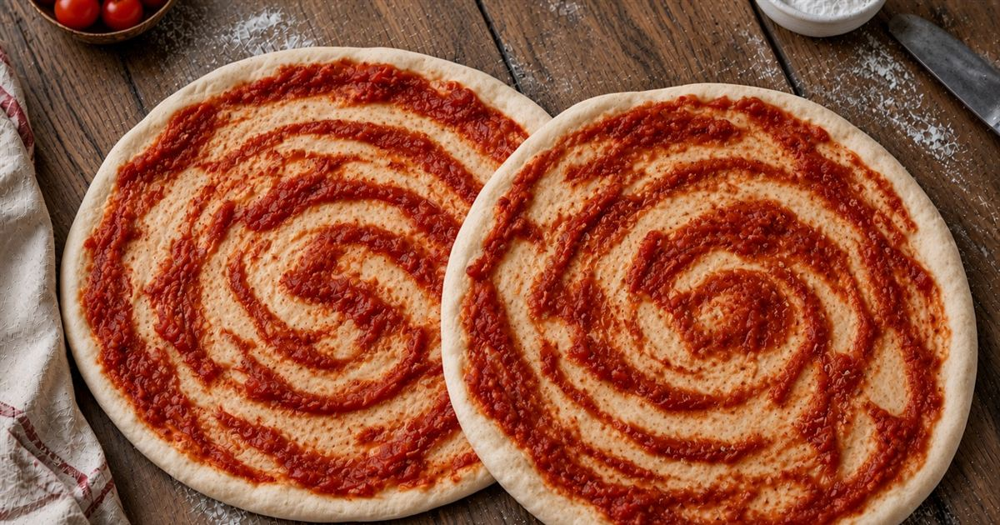

# Rústico & Casero 🍕

Sitio web para **Rústico & Casero**, un emprendimiento de prepizzas artesanales con masa madre en Ciudadela (Tres de Febrero, Buenos Aires).

🔗 **Sitio en vivo:** [rusticoycasero.pages.dev](https://rusticoycasero.pages.dev/)



## Funcionalidades

- **Catálogo de productos**: prepizzas de tomate, de cebolla y pizzetas, con foto, descripción y precio.
- **Carrito de compras**: se pueden sumar productos y ajustar cantidades. El total se calcula al instante.
- **Pedido por WhatsApp**: el carrito arma automáticamente el mensaje con el detalle del pedido y lo abre en WhatsApp, listo para enviar.
- **Mayorista y catering**: precios especiales para comercios y revendedores, y servicio de pizza party para eventos.
- **Diseño responsive**: se adapta a celulares, tablets y computadoras.
- **SEO**: meta tags y Open Graph para que el link se vea bien al compartirlo.

## Tecnologías

- [React](https://react.dev/) + [TypeScript](https://www.typescriptlang.org/)
- [Vite](https://vitejs.dev/)
- [Tailwind CSS](https://tailwindcss.com/) + [shadcn/ui](https://ui.shadcn.com/)
- React Context para el estado del carrito
- Deploy en Cloudflare Pages

## Estructura

```
src/
├── components/     # Secciones de la página (Hero, Productos, Mayorista, Contacto...) y carrito
├── context/        # CartContext: estado global del carrito
├── data/           # Catálogo de productos
├── pages/          # Página principal y 404
└── assets/         # Imágenes y logo
```

## Cómo correrlo

```sh
npm install
npm run dev
```

Para generar la versión de producción:

```sh
npm run build
```
